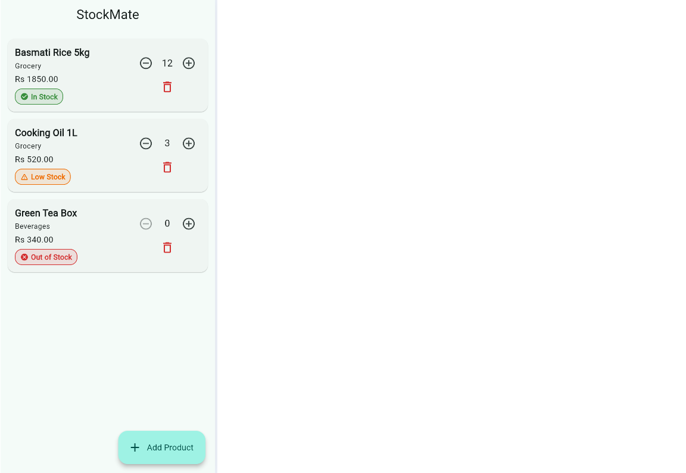
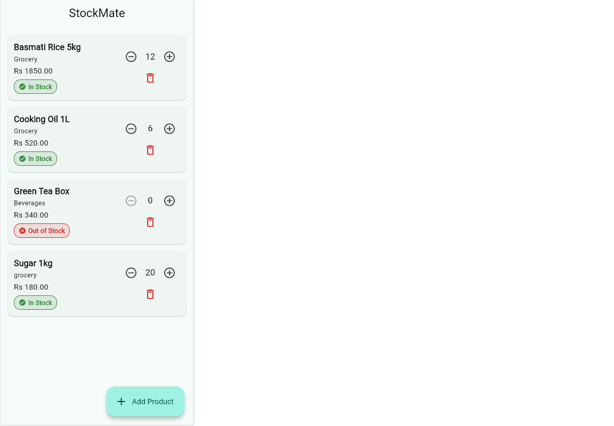
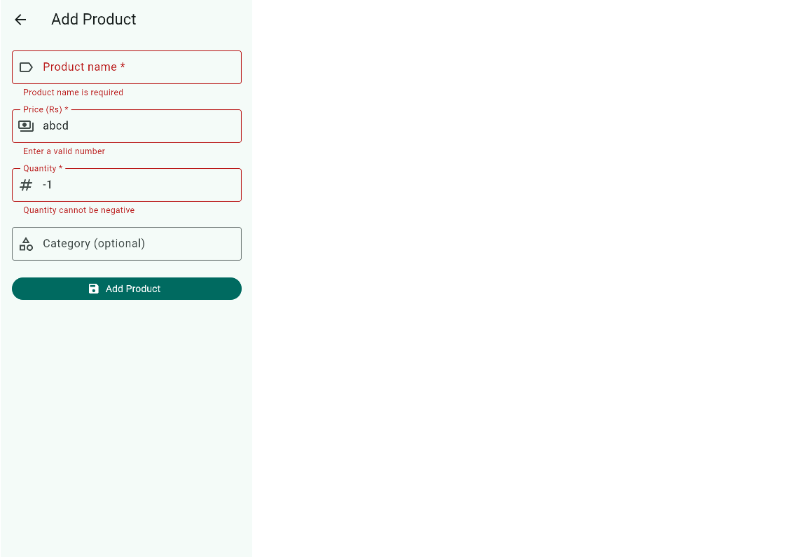
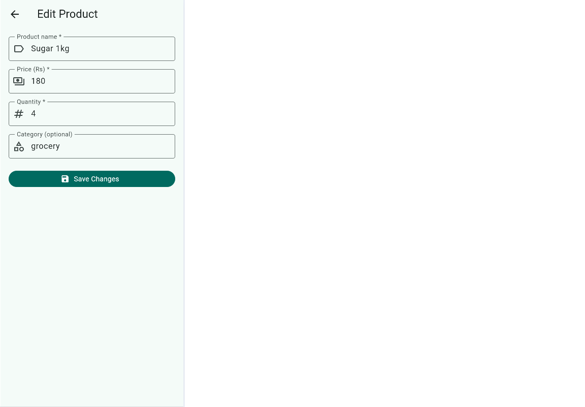

# StockMate

A simple inventory app for small shop owners. Keep track of product names, prices and quantities on your phone, and see at a glance which items are running low.

Built for the Stack & Scale Remote Internship 2026, Week 01 (Mobile App Development).

## Features

- Product list showing name, price, quantity, optional category and a stock badge
- Add, edit and delete products using validated forms
- Delete asks for confirmation first
- + / - buttons to change quantity (cannot go below 0)
- Stock indicators: In Stock, Low Stock, Out of Stock
- Products are saved on the device and are still there after the app restarts
- Empty-inventory screen and a scrollable form for small screens

## Stock status rules

The low-stock threshold is set in `lib/utils/constants.dart` as `lowStockThreshold = 5`.

| Quantity | Status | Color |
|----------|--------|-------|
| 0 | Out of Stock | Red |
| 1 to 5 | Low Stock | Orange |
| 6 or more | In Stock | Green |

## Tech

- Framework: Flutter (Dart)
- State management: `StatefulWidget` + `setState()` (no extra state packages)
- Local storage: `shared_preferences`, with products saved as one JSON string
- Navigation: `Navigator.push` / `Navigator.pop`

## Setup

Requirements: Flutter SDK installed, and an emulator or a physical device.

```bash
git clone <your-repo-url>
cd stockmate
flutter pub get
flutter run
```

Run the tests:

```bash
flutter test
```

## Project structure

```
lib/
├── main.dart                     # app entry point and theme
├── models/product.dart           # Product class, stock status, JSON conversion
├── services/storage_service.dart # save and load with shared_preferences
├── utils/
│   ├── constants.dart            # low-stock threshold, storage key
│   └── validators.dart           # form validation functions
├── screens/
│   ├── inventory_screen.dart     # product list, owns state, delete, +/-
│   └── product_form_screen.dart  # add / edit form
└── widgets/
    ├── stock_badge.dart          # status chip
    └── product_tile.dart         # one list row
test/product_test.dart            # unit tests
docs/TEST_CHECKLIST.md            # manual test checklist
```

## How state works

`InventoryScreen` holds the list of products in `_products`. Every add, edit, delete and quantity change builds a new list inside `setState()`, so Flutter rebuilds the screen and the change shows immediately. After each change the list is saved with `StorageService`. The form screen does not touch the list. It returns the finished product with `Navigator.pop`, and the inventory screen updates its own state.

## Screenshots

| Inventory list | Add product | Validation errors |
|---|---|---|
|  |  |  |

| Edit product | Delete confirmation | Empty state |
|---|---|---|
|  |  |  |

## Testing

- Unit tests (`flutter test`) cover JSON conversion, stock status rules and form validators.
- Manual testing follows `docs/TEST_CHECKLIST.md`.

## Known limitations

- No search or category filter
- No undo after deleting a product
- Prices are shown with the "Rs" label and there is no currency setting
- Data is stored only on the device, with no backup or sync
- Quantity changes by 1 per tap only

## Possible improvements

- Search and category filters
- Inventory summary cards (total items, low-stock count)
- Choosing the low-stock threshold in a settings screen
- CSV export

## AI assistance

AI tools were used during the development of StockMate to help understand Flutter concepts, plan the project structure, generate initial code, and troubleshoot errors. I reviewed the generated code, tested the application, made changes where needed, and learned how the different components work together. I used these tools as learning and development assistance while taking responsibility for understanding and testing my project.

## Author

<Anoosha Anwar> | Stack & Scale Remote Internship 2026